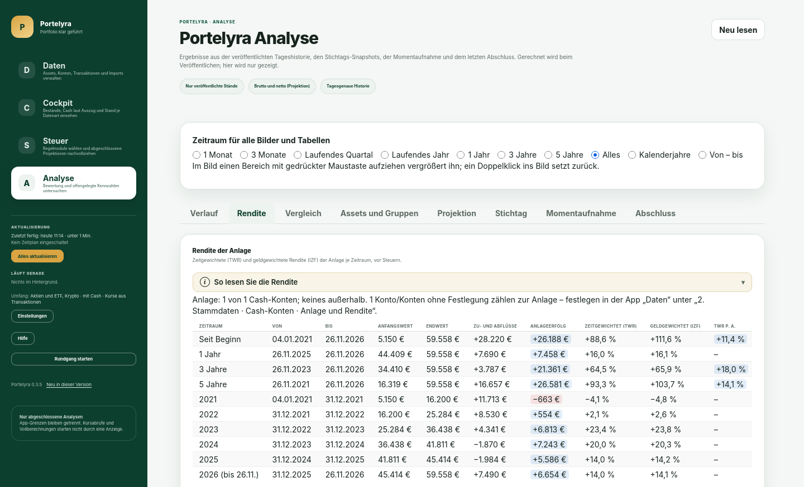

# Analyse

Die Analyse zeigt Werte und Ergebnisse aus dem veröffentlichten Stand: Verlauf, Rendite, Vergleich, Positionen und Projektion. Sie liest
nur und ruft keine Kurse ab. Alle Renditen sind vor Steuern.

## Verlauf

Gesamtvermögen, Marktwert, Einstand und Cash je Tag aus der Tageshistorie, darunter die unrealisierte GuV. Wahlweise nach Cash und
Assetklasse, in Euro oder als Anteil. Gezählt wird, was auch im Gesamtvermögen steht: bewertete Positionen und Cash.

## Rendite

Zeitgewichtete Rendite (**[TWR](glossar.md#twr)**, unabhängig davon, wann Geld ein- oder ausgezahlt wurde) und geldgewichtete Rendite (**[IZF](glossar.md#izf)**, der
interne Zinsfuß Ihrer eigenen Zahlungen) je Zeitraum. Darunter, woraus sich der Anlageerfolg eines Zeitraums zusammensetzt.

## Vergleich

Je Asset, Klasse oder eigener Gruppe die zeitgewichtete Rendite neben dem gewählten Bezugsindex, über dieselben Tage mit Bestand;
dazu eine Rangliste.

## Assets und Gruppen

Wert und Einstand über die Zeit, darunter die GuV vor Steuern; beim einzelnen Asset dazu Kurs, Menge und Buchungen (ohne Bestand ist der
Kurs gestrichelt). Für einen Zeitraum je Assetklasse und je Asset: Anlageerfolg und seine Teile, zeit- und geldgewichtete Rendite.

## Projektion

Was ein Verkauf aus einem Konto zu einem gewählten Kurs ergäbe, welcher Kurs ein Ziel erreicht und was ein Zukauf aus dem
Einstandskurs macht. Eine Rechnung mit Ihren Annahmen, keine Prognose.

## Stichtag

Der **verbindliche [Stichtags-Snapshot](glossar.md#stichtag):** Positionen zu einem gewählten Tag, mit Menge, Einstand, Kurs und Wert vom selben Tag.

## Momentaufnahme

Wie der Stichtag, aber mit den Kursen des laufenden Handelstags aus dem letzten Abruf – ein Blick zwischendurch, bevor der Tag
abgeschlossen ist ([Momentaufnahme](glossar.md#momentaufnahme)).

## Abschluss

Der geltende Abschluss und was er enthält: Auswertungen des Laufs, Handelsergebnisse je Zeitraum, Kurse des Laufs, Positionen und
Marktwerte, Summen aus den Buchungen.

## „Nicht verfügbar“ und „nicht vollständig bewertet“

Fehlt für eine Position ein Kurs oder Wechselkurs, zählt sie nicht als 0, sondern als nicht bewertet; Summen sagen dann „nicht vollständig
bewertet“. Abhilfe: Kursquelle in Data prüfen, „Alles aktualisieren“, oder für Assets ohne Anbieter eigene Kurse eintragen.
