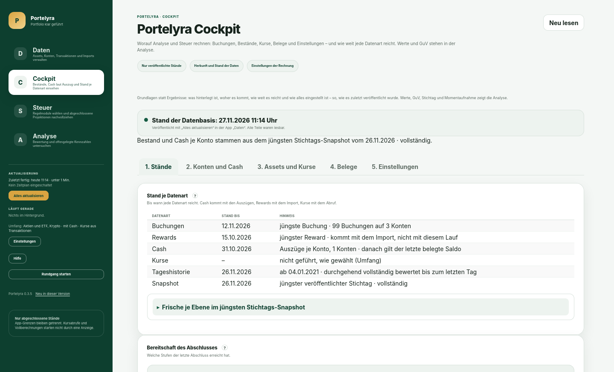

# Cockpit

Das Cockpit zeigt, **worauf Analyse und Steuer rechnen**: Buchungen, Bestände, Kurse, Belege und Einstellungen – und wie weit jede
Datenart reicht. Werte und Gewinne stehen in der Analyse. Das Cockpit liest nur den veröffentlichten Stand; es rechnet nichts und ruft
keine Kurse ab. „Neu lesen“ holt den neuesten veröffentlichten Stand.

## Stände

- **Stand je Datenart:** bis wann Buchungen, Cash, Kurse, Wechselkurse und Steuer reichen, und was der letzte Lauf geschrieben hat.
  Unterschiedliche Stände sind normal (Cash etwa nur monatlich); das Cockpit zeigt sie nebeneinander statt eines Gesamtdatums.
- **Bereitschaft des Abschlusses:** ob der nächste Lauf rechnen kann oder was ihn aufhält, mit dem Grund.

Mehr: [Wie aktuell ist der Gesamtstand?](aktueller-stand.md)

## Konten und Cash

- **Konten und Buchungen:** je Konto die Zahl der Buchungen und der Zeitraum.
- **Cash je Konto laut Auszug:** Saldo je Cash-Konto, belegt durch Auszüge oder Prüf-Salden; ein Konto ohne Beleg zeigt „nicht
  verfügbar“, nie 0.

## Assets und Kurse

- **Bestand je Asset:** Menge je Konto nach FIFO.
- **Assets, Kurszuordnung und Kursstand:** Kursquelle je Asset und der letzte Kurstag.
- **Wechselkurse:** die Paare für Assets in Fremdwährung und ihr Stand.

## Belege

**Belege der Ablage je Jahr:** was abgelegt ist, je Institut und Art.

## Einstellungen

Die Einstellungen, mit denen gerechnet wird: Bausteine des Portfolios, Kursanbieter, Steuer. Ändern lassen sie sich in Data.

## „Nicht verfügbar“

Zeigt das Cockpit „nicht verfügbar“, fehlt dem veröffentlichten Stand die Angabe. Meist hilft ein Lauf **„Alles aktualisieren“** in
Data; sonst nennt die Zeile den Grund ([Meldungen und nächste Schritte](meldungen.md)).
