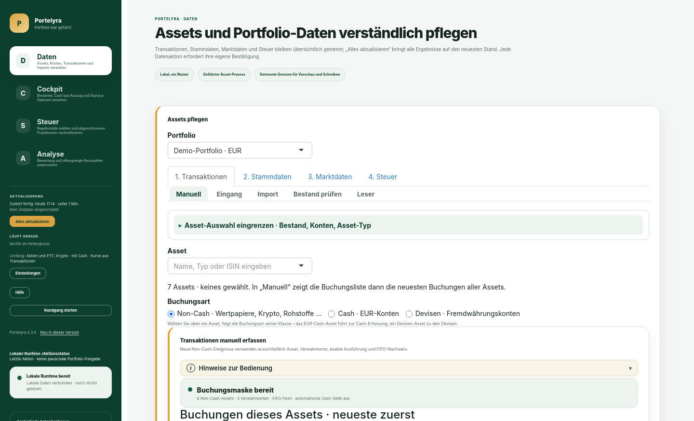

# Data

Data ist die einzige App, die schreibt: Buchungen, Stammdaten, Kurse und Steuerangaben entstehen hier. Jeder Schreibschritt läuft gleich:
**prüfen** (schreibt nichts, zeigt die Vorschau und jeden Grund dagegen), **bestätigen** (genau diese Vorschau; eine geänderte Eingabe
verlangt neu zu prüfen), **schreiben**. Nichts wird überschrieben: Eine Korrektur oder ein Storno legt einen neuen Stand an, der frühere
bleibt erhalten.

Links im Block: **„Alles aktualisieren“** (Kurse, Bestand, Tageshistorie, Steuer, Veröffentlichung), **„Läuft gerade“**,
**Einstellungen**, **Hilfe** und **Portelyra beenden**.

## Transaktionen

Alles, was den Bestand verändert. Die Unterreiter:

### Manuell

Eine Buchung von Hand: Asset suchen, Konto wählen, Art (Kauf, Verkauf, Dividende, Zins, Reward, Transfer, Einlieferung …), Tag, Menge,
Kurs, Gebühr. **„Transaktion prüfen“** zeigt die Vorschau, **„Speichern“** bucht sie. Für Cash-Konten gibt es den Modus „Cash“ (Ein- und
Auszahlung, Zins, [Prüf-Saldo](glossar.md#prüf-saldo)), für Fremdwährung den Modus „Devisen“. Kauf und Verkauf brauchen kein Cash-Konto; Portelyra bucht kein
Gegenkonto von selbst.

Darunter die Buchungen des gewählten Assets: **korrigieren** oder **stornieren** über die Vorschau, nie löschen.

### Eingang

Der monatliche Weg für Belege: Belegordner prüfen, die Dateien je Institut in die Ablage übernehmen, danach im Import buchen. Erscheint
wie Import, Leser und Ablage nur mit dem Baustein „Import aus Belegen und Auszügen“. Ausführlich: [Monatlicher Eingang](monatlicher-eingang.md).

### Import

Belege einlesen: **Wertpapier-Belege**, **Krypto-Exporte**, **Rewards**, **Cash-Auszüge**, **Devisen-Belege**. Immer dieselben Schritte:
Dateien oder einen Ordner wählen, **„Belege prüfen“** (schreibt nichts), Depot oder Konto zuordnen, Vorschau, buchen. Gebucht wird nur
Neues; schon Gebuchtes wird erkannt. Zeilen, die der Leser nicht sicher versteht, bleiben mit Grund offen und lassen sich „im Editor
öffnen“. Welcher Leser was liest: [Import je Institut](importer/README.md). Erscheint nur mit dem Baustein „Import aus Belegen und
Auszügen“; ohne ihn buchen Sie von Hand.

### Bestand prüfen

Der Stand nach FIFO je Asset und Konto: was gebucht ist, ob etwas fehlt (etwa eine Einlieferung ohne Anschaffung) und ob der Bestand zu
den Belegen passt. Hier steht auch, wenn eine Buchung den Bestand unter null führen würde.

### Leser

Je Leser für Belege: Version, Prüfsumme, ob er an Ihren Belegen geprüft ist, wie viele Buchungen er geliefert hat. Ein **Selbsttest**
läuft auf Knopfdruck. Nach einem Update kann ein Leser einmal „nicht geprüft“ sein, wenn sich sein Code geändert hat. Erscheint nur mit
dem Baustein „Import aus Belegen und Auszügen“.

### Kursanbieter

Welche Kursanbieter eingeschaltet sind, für alle Portfolios gemeinsam: Adressen, Kosten, Bedingungen, Abschottung, Selbsttest. Erscheint
nur mit dem Baustein „Marktdaten“. Ohne Anbieter bewertet Portelyra mit den Kursen Ihrer Buchungen oder eigenen Angaben.

## Stammdaten

Was gebucht werden kann.

### Assets

Wertpapiere, Coins, Edelmetalle und Cash-Assets mit Typ, Preiswährung, Skala (Nachkommastellen der Menge) und Kennungen (ISIN, WKN,
Symbol). Hier entsteht ein neues Asset, und hier steht die Zusammenfassung des gewählten.

### Konten und Institute

Depots, Wallets, Bank- und Fremdwährungskonten, je mit Institut. Ein Konto lässt sich als geschlossen kennzeichnen; seine Buchungen
bleiben.

### Ablage

Die abgelegten Belege je Institut und Jahr, mit Prüfsumme. Daraus entsteht unter Steuer „Unterlagen des Jahres“. Erscheint nur mit dem
Baustein „Import aus Belegen und Auszügen“.

### FIFO-Wallet

Nur für Krypto: welche Wallets für FIFO zusammengehören. Die Zuordnung legen Sie selbst an. In der Karte „Krypto · Wertermittlung je
Wallet“ lässt sich je Coin und Wallet statt FIFO der Durchschnitt wählen; die Haltefrist folgt weiter FIFO ([FIFO](glossar.md#fifo)).

### Kapitalmaßnahmen

Splits und andere Kapitalmaßnahmen je Asset. Ein Split teilt Menge und Kaufpreis der Lots, ohne Gewinn.

### Anlage- und Analyse-Einstellungen

Welche Assets zur Anlage zählen, Bezugsindex, Gruppen für die Analyse.

## Marktdaten

Kurse und Wechselkurse.

### Kursquelle

Je Asset die Kursquelle: Anbieter mit Symbol, eigene Kursangaben oder die Kurse der Buchungen. Die Bewertungsmethode kann über die Zeit
wechseln (Bewertung über die Zeit).

### Einrichten

Neue Assets mit dem Anbieter verbinden: Vorschlag suchen, ein Testabruf, Freigabe. Erst eine freigegebene Zuordnung holt Kurse.

### Bewerten

Kurshistorie je Asset und der Stand der Bewertung. Wechselkurse für Assets in Fremdwährung.

### Bei Problemen

Lücken in Kursreihen, unterbrochene Abrufe, Kalenderlücken und manuelle Nachweise.

## Steuer

Erscheint nur mit dem Baustein „Steuerbericht“. Die steuerliche Einordnung bestätigen Sie selbst; was ein Kursanbieter meldet, gilt
nicht als Einordnung.

- **Regelmodul:** welches Jahresmodul je Steuerjahr rechnet ([Steuer: was das Regelmodul abdeckt](steuer-umfang.md)).
- **Vorgabe je Asset-Typ:** Aktie, Fonds, Kapitalinstrument, Krypto, Cash / Zinsen.
- **Steuerangaben je Jahr:** persönlicher Steuersatz, Kirchensteuer, weitere Parameter.
- **Freistellung, Verlusttöpfe und Quellensteuer je Institut** ([Sparer-Pauschbetrag](glossar.md#sparer-pauschbetrag),
  [Verlusttopf](glossar.md#verlusttopf), [Quellensteuer](glossar.md#quellensteuer)).
- **Vorabpauschalen je Fonds und Konto** ([Vorabpauschale](glossar.md#vorabpauschale)) und **steuerpflichtige Beträge aus der
  Erträgnisaufstellung**.

## Einstellungen

Links unter **Einstellungen**, aus jeder App erreichbar. Sie gelten für alle Apps und sind in sechs Unterreiter gegliedert.

### Portfolio

Portfolios anlegen und umbenennen, dazu der **Umfang dieses Portfolios**: welche Assetklassen und Bausteine es führt, etwa ob es außer
von Hand auch aus Belegen und Auszügen bucht.

### Anzeige und Berechnung

Nachkommastellen, farbige Kennzahlen, Linien im Verlauf, Kleinstbestände; der Schalter **Expertenwerkzeuge** (ältere Importwege und
Prüfwerkzeuge, für den Alltag nicht nötig); Zeitraum der Analyse beim Öffnen; **Kursabruf** (ab wann ein Tageskurs gilt) und die
Tageshistorie. Ein gemeinsamer Knopf speichert alles.

### Automatik

**Von selbst aktualisieren:** Zeitplan für „Alles aktualisieren“ und für die Momentaufnahme.

### Sicherheit und Speicher

**Passwortschutz**, **Backups** und **Speicher aufräumen**.

### Plugins und Zugänge

**Plugins** (Leser, Kursanbieter, Steuermodule: ansehen, prüfen, installieren) und **Zugänge** (Schlüssel für Plugins im
Schlüsselbund).

### Programm

Gilt für diese Installation, nicht je Portfolio.

- **Version:** welche Version von Portelyra läuft, seit wann, und **„Neu in dieser Version“**. Die Version steht auch ganz unten im
  Block links jeder App; „Neu in dieser Version“ führt von dort hierher. Nach einem Update zeigt Daten die Neuerungen einmal oben an.
- **Updates:** **„Nach Updates suchen“** fragt einmal bei GitHub nach, ob es eine neuere Version gibt, und zeigt sie mit ihren
  Versionshinweisen. Darunter wählen Sie, ob Portelyra **einmal am Tag automatisch** sucht oder **nur auf Klick**. GitHub erfährt dabei
  Ihre IP-Adresse und den Zeitpunkt, nichts aus Ihrem Bestand. Gibt es eine neuere Version, steht sie links in jeder App. In derselben
  Karte laden Sie sie herunter, lassen sie prüfen (Größe, Prüfsumme, Signatur) und spielen sie mit einer Bestätigung ein; eine eigene Seite
  zeigt dann die Schritte ([Update](update.md)).
- **Browser:** In welchem Browser sich Portelyra öffnet. Vorgabe ist der Standardbrowser des Systems. Angeboten werden nur Browser, die
  auf dem Rechner installiert sind, auch als Snap oder Flatpak. Die Wahl gilt ab dem nächsten Öffnen, auch beim zweiten Klick auf den
  Starter. Ist der gewählte Browser nicht mehr da, öffnet der Standardbrowser, und ein Hinweis am Bildschirmrand sagt es.
  Geprüft wird Portelyra mit Firefox; andere aktuelle Browser sollten funktionieren. Wer im Terminal mit `--browser` startet, bestimmt
  damit den Browser für diesen Start.
- **Lizenz:** Copyright, die Bedingungen der GNU AGPL zum Weitergeben und Verändern, der Ausschluss der Gewährleistung und
  **„Lizenztext anzeigen“** mit dem vollständigen Text aus dem Programmordner ([Lizenz](lizenz.md)).

## „Nicht verfügbar“

Fehlt ein Kurs, ein Wechselkurs oder eine Angabe, zeigt Data „nicht verfügbar“ und den Grund, nie eine 0. Was zu tun ist, steht bei der
Meldung und unter [Meldungen und nächste Schritte](meldungen.md).
