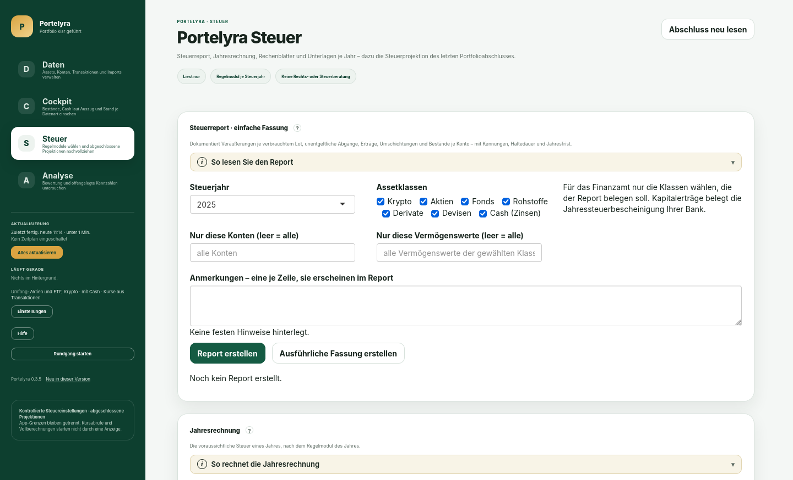

# Steuer

Die App Steuer zeigt den Steuerteil des letzten veröffentlichten Abschlusses: Steuerreport, Jahresrechnung, Rechenblätter und
Unterlagen je Jahr, dazu die Steuerprojektion. Sie liest nur; gerechnet wird beim Lauf „Alles aktualisieren“ in Data. Das Regelmodul je
Steuerjahr bestimmt die Regeln ([Steuer: was das Regelmodul abdeckt](steuer-umfang.md)).

> Keine Rechts- oder Steuerberatung. Die Zahlen helfen beim Ausfüllen und Prüfen; maßgeblich bleiben Gesetz, Bescheid und die
> Abrechnungen der Institute.

## Steuerreport · einfache Fassung

Steuerjahr und Assetklassen wählen, auf Wunsch einzelne Konten oder Vermögenswerte, dann **„Report erstellen“**. Der Report dokumentiert
Veräußerungen je verbrauchtem Lot, unentgeltliche Abgänge, Erträge, Umschichtungen und Bestände je Konto – mit Kennungen, Haltedauer und
[Jahresfrist](glossar.md#jahresfrist). Mit dem Häkchen „Cash (Zinsen)“ kommen die Zinsgutschriften der Cash-Konten dazu. Er berechnet selbst keine Steuer.

Die **ausführliche Fassung** hängt Jahresrechnung und Rechenblätter an, als ein PDF; sie rechnet dafür alle Jahre ab 2020 (bis zu drei
Minuten).

## Jahresrechnung

Die Steuer eines Jahres: Kapitalerträge je Institut, private Veräußerungsgeschäfte, [Verlusttöpfe](glossar.md#verlusttopf) aus dem Vorjahr,
[Freistellung](glossar.md#sparer-pauschbetrag) und [Quellensteuer](glossar.md#quellensteuer), mit den Zinsen der Cash-Konten. Gibt es in einem Jahr keine steuerlich relevanten Ereignisse, sagt die Karte das, statt
zu rechnen – gab es doch Verkäufe oder Erträge, fehlen sie noch im Bestand.

## Rechenblatt je Ereignis

Je Verkauf oder Ertrag, wie die Zahl entsteht: verbrauchte Lots, Anschaffung, Erlös, Gebühren, Haltedauer,
[Teilfreistellung](glossar.md#teilfreistellung), Steuer.

Über den Blättern stehen die Summen: insgesamt, je Institut und Konto und **nach Topf**. Unter den steuerpflichtigen Töpfen zeigt die
Tabelle, was vom Gewinn bzw. Ertrag nicht besteuert wird: Lots nach Ablauf der Jahresfrist (nur bei privaten Veräußerungsgeschäften),
die Teilfreistellung bei Fonds, schon versteuerte [Vorabpauschalen](glossar.md#vorabpauschale) und die Rundung auf Cent, dazu Blätter ohne Steuerzahl. Zusammen
ergeben die Zeilen den Gewinn bzw. Ertrag der Gesamtzeile. Ein Verkauf mit Lots in und nach der Frist zählt in beiden Zeilen.

## Unterlagen des Jahres

Die abgelegten Belege eines Jahres als ZIP, nach Institut und Art geordnet – für die Steuererklärung oder den Steuerberater.

## Steuerprojektion

**Stand des Portfolioabschlusses**, **Steuerprojektion je Jahr** und **je Ereignis** zeigen, was der letzte Abschluss gerechnet hat –
nicht den heutigen Stand der Einstellungen. „Unvollständig“ heißt: Ereignisse des Jahres blieben ohne Steuerzahl, meist fehlte beim
Abschluss eine Angabe. Nachtragen in Data → „4. Steuer“ → „Steuerangaben je Jahr“, danach „Alles aktualisieren“.

Die Projektion je Ereignis ist konservativ: ohne Freistellungsauftrag, Verlustverrechnung und Quellensteuer.

## Ohne Steuer

Ist der Baustein „Steuerbericht“ nicht gewählt, zeigt die App „ohne Steuer, wie gewählt“. Einschalten lässt er sich in den Einstellungen
des Portfolios.
