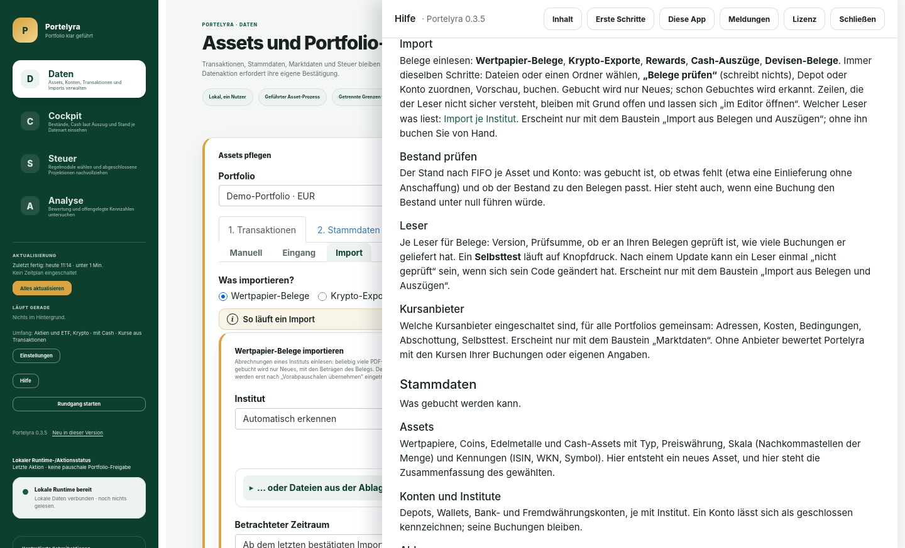
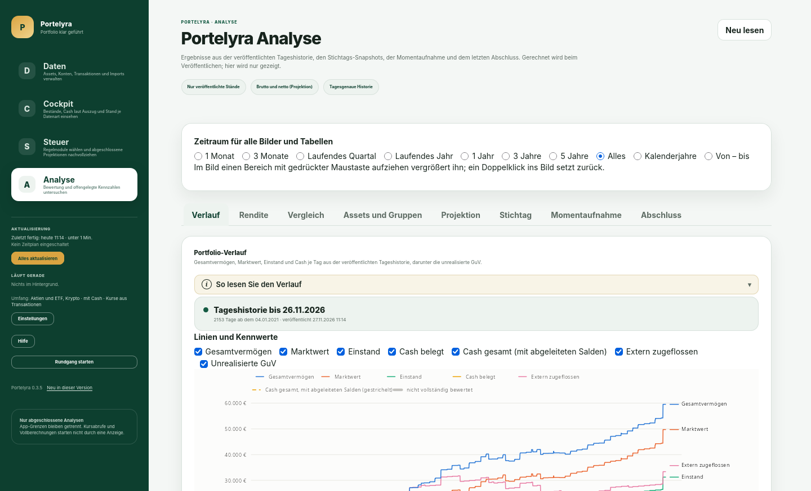
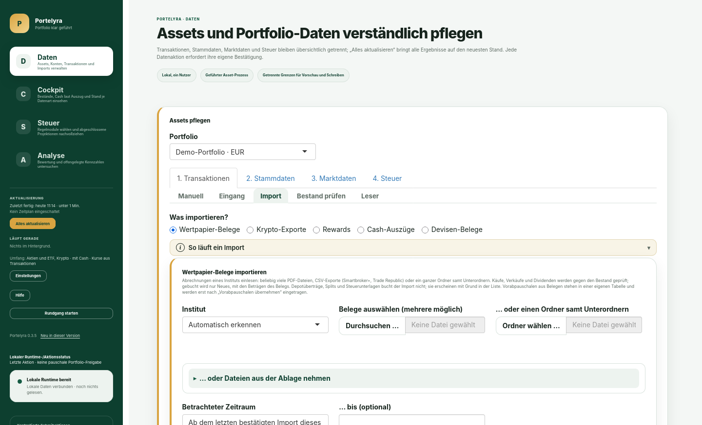

# Erste Schritte

Einmal durch Portelyra, am Demo-Portfolio: einrichten, Kurse holen, Verlauf und Rendite lesen, eine Buchung erfassen, einen Beleg
importieren, den Steuerbericht ansehen und ein Backup anlegen. Rechnen Sie mit gut einer Stunde, davon einige Minuten Wartezeit.

Das Demo ist ein eigenes, vollständiges Portelyra mit erfundenem Bestand auf echten, bekannten Assets. Es liegt getrennt von Ihrem
eigenen Portfolio; was Sie im Demo tun, berührt Ihre Daten nie ([Das Demo-Portfolio](demo.md)).

> Portelyra ist eine Beta, ohne Gewähr, und keine Anlage- oder Steuerberatung.

## 1. Installieren

Einmal im Terminal, rund eine Viertelstunde: [Installation](installation.md). Danach steht **Portelyra** im Anwendungsmenü. Ein Klick
führt immer zu Portelyra, auch wenn es schon läuft. Beenden: **Portelyra beenden** links in jeder App, oder Rechtsklick auf das Symbol.

## 2. Einrichten

Beim ersten Start erscheint zuerst **„Bevor Sie beginnen“**: Portelyra ist eine Beta ohne Gewähr und keine Anlage-, Steuer-
oder Rechtsberatung; Pflege und Prüfung Ihrer Daten liegen bei Ihnen. Mit dem Häkchen „gelesen und verstanden“ geht es weiter.

Danach fragt der Einrichtungsdialog nacheinander:

- **Portfolio:** Name und Währung (für die Beta Euro).
- **Was Sie erfassen:** Aktien und ETF, Fonds, Anleihen, Krypto, Edelmetalle, Derivate, Bankkonten und Cash – mehrere möglich.
- **Wie Sie buchen:** von Hand ist immer dabei, auf Wunsch auch aus Belegen und Auszügen: Import, monatlicher Eingang und Belegablage.
  Der Abruf per Schnittstelle folgt später.
- **Institute:** nur mit Belegen – bei welchen Instituten Sie Konten haben; Portelyra aktiviert deren Leser. Dazu auf Wunsch Ihr
  Belegordner für den [monatlichen Eingang](monatlicher-eingang.md).
- **Wofür:** Wert und Entwicklung verfolgen (mit Kursen) und Steuer. Was Sie abwählen, fehlt nicht, es ist „wie gewählt“ aus.
- **Kurse:** Yahoo Finance oder kein Anbieter. Ohne Anbieter bewertet Portelyra mit den Kursen Ihrer Buchungen.
- **Von selbst aktualisieren:** nein, täglich um 07:00 Uhr oder zweimal täglich.
- **Steuer:** Ihr [persönlicher Steuersatz](glossar.md#persönlicher-steuersatz) („weiß ich nicht“ geht auch) und Kirchensteuer.
  Portelyra rechnet nach deutschem Steuerrecht; für die Beta gilt nur Deutschland. Gemeint ist der Grenzsteuersatz, nicht der
  Durchschnitt aus dem Steuerbescheid (der ist niedriger). Zur Orientierung, ohne Gewähr (2026, je Person): bis 12.348 € zu
  versteuerndem Einkommen 0 %, danach ab 14 % steigend, 42 % ab 69.879 €, 45 % ab 277.826 €. Genau rechnet der
  [Steuerrechner des Bundesfinanzministeriums](https://www.bmf-steuerrechner.de/).
- **Passwortschutz** für Ihre Daten (empfohlen).

Am Ende steht eine Zusammenfassung; erst mit **„Übernehmen und Portelyra starten“** gilt etwas. Der Entwurf bleibt beim Schließen erhalten.

**Wie viel Sie erfassen, entscheiden Sie.** Ein einzelnes Depot, erst ab einem Jahr, Cash nur mit Monatssalden: Alles ist ein gültiges
Portfolio. Was fehlt, zeigen die Apps als „nicht verfügbar“ oder „nicht vollständig bewertet“ an, statt es zu schätzen.

## 3. Das Demo öffnen

Im Einrichtungsdialog unter **„Erst das Demo-Portfolio ansehen“**:

- **„Demo mit aktuellen Kursen ansehen“** schaltet im Demo den Kursanbieter Yahoo Finance ein (die Hinweise des Anbieters stehen beim
  Knopf).
- **„Demo ohne Netz ansehen“** bewertet mit den Kursen der Buchungen und, für vier selten gekaufte Assets, mit erfundenen
  Kursangaben. Sie sind keine Marktkurse und können von den echten Kursen abweichen; der Verlauf bewegt sich in Stufen
  ([Kurse im Demo](demo.md#kurse-im-demo)).

Der erste Aufbau dauert drei bis fünf Minuten; die Seite zeigt die Schritte. Das Demo öffnet sich danach in einem eigenen Tab, auf den
Ports ab 4838. Ihre eigene Einrichtung bleibt offen und lässt sich jederzeit fortsetzen.

**Der Rundgang:** Beim ersten Öffnen beginnt in „Daten“ ein Rundgang durch die Schritte dieser Seite, über alle vier Apps. Ein roter
Pfeil zeigt auf das Bedienelement, „Zeig es mir“ öffnet die Stelle. Die Eingaben machen Sie selbst: Für jedes Feld nennt der Rundgang
einen Wert, der im Demo passt, und hakt ab, was erledigt ist. Gebucht wird nur mit Ihrer Bestätigung, wie sonst auch. „Beenden“ schließt
ihn, links unter **„Rundgang starten“** beginnt er jederzeit neu.



## 4. „Alles aktualisieren“

Links in jeder App steht **„Alles aktualisieren“**. Ein Klick (er wechselt nach Data) holt, was fehlt, und rechnet nur, was sich
geändert hat:

1. Kurse und Wechselkurse bis zum letzten abgeschlossenen Handelstag, wenn ein Kursanbieter eingeschaltet ist;
2. Bestand nach [FIFO](glossar.md#fifo), Tageshistorie, Steuer;
3. die [Veröffentlichung](glossar.md#veröffentlichung): Erst danach sehen Cockpit, Steuer und Analyse den neuen Stand.

**Warum ein eigener Schritt?** Banken und Börsen rechnen Depotwerte laufend auf ihren Servern. Portelyra hat bewusst keinen Server:
Ihre Daten bleiben auf Ihrem Rechner, ins Netz geht es nur zum Kursanbieter, wenn Sie einen gewählt haben. Deshalb rechnet Portelyra,
wenn Sie es anstoßen – oder von selbst: **„Von selbst aktualisieren“** (im Einrichtungsdialog, später unter **Einstellungen** links → „Automatik“)
startet denselben Lauf zu festen Uhrzeiten, auch wenn Portelyra geschlossen ist. Das lohnt sich vor allem, wenn der Rechner tagsüber
ohnehin läuft; war er aus, holt der Zeitplan den Lauf beim nächsten Anmelden nach.

Unter **„Läuft gerade“** steht, was arbeitet und wie lange noch. **Das erste Mal dauert länger**, weil alles neu entsteht: Kurshistorien
je Asset, FIFO-Stand, Tageshistorie. Danach geht es in Sekunden bis wenigen Minuten. Wie aktuell jede Datenart ist, zeigt das Cockpit
unter „Stände“ ([Wie aktuell ist der Gesamtstand?](aktueller-stand.md)).

## 5. Verlauf und Rendite lesen

In der **Analyse**:

- **Verlauf:** Gesamtvermögen, [Marktwert](glossar.md#marktwert), [Einstand](glossar.md#einstand) und Cash je Tag, darunter die
  [unrealisierte GuV](glossar.md#unrealisierte-guv): Gewinn oder Verlust der Positionen, die Sie noch halten, bewertet zu den aktuellen
  Kursen („Buchgewinne und Buchverluste“). Realisiert wird er erst beim Verkauf.
- **Rendite:** die zeitgewichtete Rendite ([TWR](glossar.md#twr), unabhängig vom Zeitpunkt der Einzahlungen) und der interne Zinsfuß
  ([IZF](glossar.md#izf), Ihre persönliche Rendite mit Ein- und Auszahlungen) je Zeitraum, vor Steuern. Ein Wert „nicht verfügbar“
  nennt den Grund.
- **[Stichtag](glossar.md#stichtag):** der Bestand an einem abgeschlossenen Tag, mit Einstand, Kurs, Wert und Gewinn je Position.
- **[Momentaufnahme](glossar.md#momentaufnahme):** derselbe Bestand zu den Kursen des laufenden Handelstags aus dem letzten Abruf – ein
  Blick zwischendurch, bevor der Tag abgeschlossen ist.



Fachbegriffe erklärt das [Glossar](glossar.md); die Seite der App: [Analyse](app-analyse.md).

## 6. Eine Buchung erfassen

In **Data → 1. Transaktionen → Manuell**:

1. Oben das Asset suchen und das Konto wählen. Zum Üben eignet sich der ETF: Im Demo ohne Netz tragen Allianz, Apple, Bitcoin und
   Ethereum erfundene Kursangaben, dort ändert eine Buchung Menge und Einstand, aber nicht den Kurs.
2. Art wählen (etwa **Kauf**) und das Konto. Bei „Zeitangabe“ genügt **„Nur Datum bekannt“**; sonst gehört die Uhrzeit dazu. Dann
   Tag (im Kalender oder als TT.MM.JJJJ), Menge, Kurs und Gebühr eintragen.
3. **„Transaktion prüfen“:** Die Vorschau zeigt, was gebucht wird, und nennt jeden Grund, der dagegen spricht.
4. **„Speichern“** bucht genau diese Vorschau. Ändern Sie danach etwas, prüfen Sie neu. Die Liste darunter lädt von selbst.

Eine falsche Buchung wird nicht gelöscht, sondern **korrigiert oder storniert**; die frühere bleibt nachvollziehbar erhalten.

**Gibt es das Asset noch nicht?** Findet die Suche es nicht, legen Sie es zuerst an: **Data → 2. Stammdaten → Assets**, bei „Vorgang“
**„Neues Asset anlegen“**. Art wählen (etwa Aktie, ETF oder Krypto), Name und Kennung (ISIN oder Symbol) eintragen und bestätigen;
mit Kursanbieter schlägt dessen Suche Art und Kurswährung vor. Danach findet die Suche unter „Manuell“ das neue Asset. Beim Import
geht es ohne Umweg: Fehlt zu einem Beleg das Asset, führt **„Fehlendes Asset anlegen“** in die Stammdaten und danach zurück zum
Import.

## 7. Einen Beleg importieren

Das Demo bringt einen erfundenen Beleg mit: einen Export im Format von Trade Republic mit einem Kauf und einer Dividende auf Assets des
Demos. Er liegt im Demo-Ordner unter

```
~/.local/share/portelyra-demo/beispielbeleg/trade-republic-transactions.csv
```

In **Data → 1. Transaktionen → Import**:

1. Bei „Was importieren?“ **Wertpapier-Belege** wählen, als Institut **Trade Republic**.
2. **„Belege auswählen“** und die Datei öffnen. Der Ordner ist versteckt: Im Dateidialog zeigt **Strg+H** versteckte Ordner, oder
   **Strg+L** und den Pfad eingeben.
3. **„Belege prüfen“** liest die Datei, schreibt aber nichts.
4. **Depot zuordnen:** dem Depot aus dem Beleg das **Demo-Depot** zuordnen, dann erneut „Belege prüfen“. Jetzt zählt Portelyra die
   neuen Vorgänge; die Assets erkennt es an der ISIN.
5. Beim ersten Import mit einem Leser: die gefundenen Vorgänge mit dem Beleg vergleichen und das Häkchen **„Ich habe die Vorschau mit
   den Belegen verglichen …“** setzen.
6. **„Neue Vorgänge vorbereiten“** zeigt die Vorschau, **„Neue Vorgänge buchen“** bucht genau diese.



Ein zweiter Import derselben Datei bucht nichts doppelt: Schon Gebuchtes wird erkannt.

**Für Ihre eigenen Belege** braucht Ihr Portfolio „aus Belegen und Auszügen“ (im Einrichtungsdialog oder in den Einstellungen unter
„Umfang dieses Portfolios“). Die Leser der Institute, die Sie im Einrichtungsdialog gewählt haben, sind schon aktiv. Jeden weiteren
aktivieren Sie selbst: Ein neues Portfolio beginnt ohne aktive Leser, damit nur angeboten wird, was Sie brauchen. **Daten → 1. Transaktionen → Leser**, Karte **„Aktivierung je Portfolio“**: Häkchen beim
Institut, „Änderungen prüfen“, bestätigen. Im Demo ist der Leser für Trade Republic schon aktiv. Erkennt der Import einen Beleg,
dessen Leser nicht aktiv ist, nennt er ihn und diesen Weg. Mehr: [Import je Institut](importer/README.md) und
[Monatlicher Eingang](monatlicher-eingang.md).

## 8. Den Steuerbericht ansehen

Nach „Alles aktualisieren“ in der App **Steuer**:

- **Steuerreport · einfache Fassung:** Steuerjahr und Assetklassen wählen, **„Report erstellen“**. Er dokumentiert Veräußerungen je
  verbrauchtem Lot, Erträge, unentgeltliche Abgänge, Umschichtungen und Bestände je Konto, mit Haltedauer und Jahresfrist. Die
  ausführliche Fassung hängt Jahresrechnung und Rechenblätter an (ein PDF).
- **Jahresrechnung** und **Rechenblatt je Ereignis:** wie jede Zahl entsteht, bis zum einzelnen Lot.

Das Demo rechnet mit einem erfundenen [persönlichen Steuersatz](glossar.md#persönlicher-steuersatz) von 30 %. Er gilt nur für
Einkünfte, die mit dem persönlichen Satz besteuert werden: private Veräußerungen wie Krypto und sonstige Einkünfte wie
Staking-Rewards. Kapitalerträge – Dividenden, Zinsen, Gewinne aus Aktien, ETF und Fonds – rechnet Portelyra mit
der festen [Abgeltungsteuer](glossar.md#abgeltungsteuer) (25 % zuzüglich Solidaritätszuschlag und gegebenenfalls Kirchensteuer).
Liegt ein persönlicher Satz unter 25 %, kann die Günstigerprüfung weniger ergeben; diesen Sonderfall rechnet Portelyra bewusst nicht
und bleibt beim festen Satz, im Zweifel also vorsichtig. Was das Regelmodul abdeckt: [Steuer: was das Regelmodul
abdeckt](steuer-umfang.md); die Seite der App: [Steuer](app-steuer.md).

## 9. Ein Backup anlegen

**Einstellungen** (links) → **„Sicherheit und Speicher“** → Karte **„Backups“** → Kästchen setzen → **„Backup anlegen“**. Portelyra läuft dabei weiter. Backups legt
Portelyra auf diesem Rechner ab. Eine Kopie zusätzlich außerhalb des Rechners aufzubewahren, etwa auf einem USB-Stick oder einer
externen Festplatte, liegt in Ihrer Verantwortung – erst sie schützt vor einem Defekt des Rechners: [Backups in der App](backups.md),
[Backup zurückspielen](wiederherstellen.md).

## Danach: das eigene Portfolio

Zurück im Tab der Einrichtung richten Sie Ihr eigenes Portfolio ein. Das Demo bleibt, bis Sie es entfernen ([Das
Demo-Portfolio](demo.md)). Für Updates genügt ein Befehl: [Update einspielen](update.md). Meldet eine App etwas, steht unter
[Meldungen und nächste Schritte](meldungen.md), was zu tun ist.
